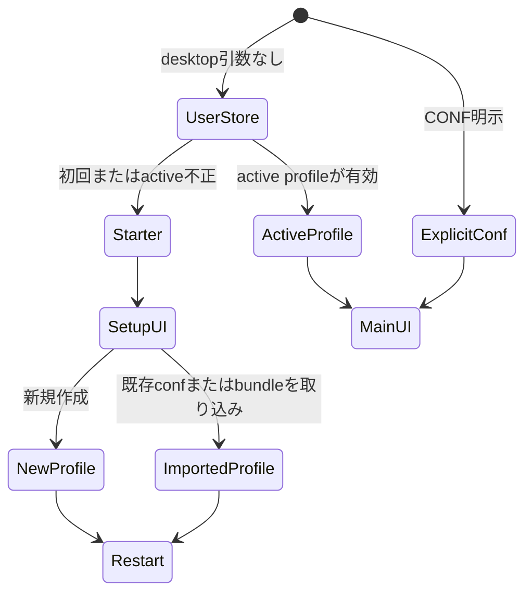

# UNVAC v2 デスクトップ体験設計

## 目標

UNVAC は AI 常駐型の配信支援、デスクトップAIアシスタント、Flowgraph と各種 ingress / effect を組み合わせるデータ処理基盤を同時に担う。能力を最初の画面へ列挙するのではなく、ユーザーが現在行いたい作業に必要な操作だけを見せ、利用の進行に伴って構造と拡張性を認知できるアプリにする。

一般ユーザー向けの簡略版と高度ユーザー向けの別製品には分けない。同じ profile、runtime、Flowgraph を、状況に応じた異なる解像度で操作できる構造にする。

## 体験原則

1. **起動自体に設定ファイルを要求しない。** desktop は引数なしでGUIを表示する。
2. **最初の判断を最小化する。** 用途を配信AI、デスクトップAI、データ連携、空構成から選び、名前を付けるだけで開始できるようにする。
3. **日常操作と構築操作を分離する。** Now / Live は運用、Flowgraph Studio は構築、Observability は診断。
4. **機能一覧ではなく結果を見せる。** 「Twitchを接続」「AIを追加」「OBSへ表示」のような達成単位から必要な設定へ導く。
5. **高度機能を隠し切らない。** 実行結果、接続、使用中Flowgraphから詳細へ辿れるようにし、能力の存在を文脈内で知らせる。
6. **エラーを設定ファイルへ追い返さない。** 問題、影響、修正操作を同じ画面に置く。TOML直接編集は最後の手段。

## Profile store

通常の desktop 起動は UNMotion のユーザーストア規約を踏襲する。

```text
%APPDATA%\UN Virtual Avatar Connect\
  settings.toml
  profiles\
    default\
      conf.toml
      credentials\
        openai-api-key.txt
      flowgraph\
      resources\
    streaming\
      conf.toml
      flowgraph\
      resources\
```

`settings.toml` は active profile ID と onboarding 完了状態だけを持つ。各 profile は独立した作業ルートであり、相対パスは profile directory を基準とする。`CONF` を明示した起動は portable / development mode として従来どおり許可するが、通常GUIの profile storeへ暗黙コピーしない。

新規desktop profileは `web_ui_address = "127.0.0.1:46000"` を明記する。従来の既定 `57000` はWindowsの動的ポート除外範囲へ入る場合があるためだ。managed profileへ取り込む既存confもこの値へ正規化し、conf pathを明示するportable・開発起動だけは値を変更しない。

初回起動時は内部 starter profile を生成してAppCoreとGUIを成立させる。starterは完成済みユーザープロファイルとして扱わず、GUIをセットアップ状態にするための安全な最小runtime。ユーザーが新規作成または既存confを取り込んだ時点でactive profileを確定する。

### 用途別template

templateは別形式の設定を増やさず、通常の `conf.toml` と `flowgraph/` を生成する。`profile.toml` の `template_id` はGUIで由来を表示するための情報であり、runtimeの分岐条件にはしない。

| template | 初期内容 |
|---|---|
| 配信AI | AI発話のOS TTS出力、AvatarIntentからUNMF/Zへのアバター反応出力 |
| デスクトップAI | Web入力のOS TTS出力、AI発話のOS TTS出力 |
| データ連携・自動化 | 状態を持つ最小Flowgraph |
| 空から作る | starter confのみ |

templateはAPI key、AI persona、Twitch認証を自動生成しない。UNMF/Z出力も `dry_run = true` で作成する。外部サービスや実アバターへの接続はResourcesからユーザーが確認して有効化する。

### Profile bundle

既存構成は `conf.toml` と関連ファイルをZIPにまとめて取り込める。ZIP直下または単一の親directory直下に `conf.toml` を置き、`flowgraph/`、`resources/` などconfから参照する相対構造を保つ。

GUIでは既存ZIPに加え、workspaceフォルダーを直接選択できる。フォルダー直下に複数の `conf*.toml` がある場合は使用するconfを選び、そのconfと参照先のTOML / JSONを再帰的に解析して、実在する相対参照ファイル・ディレクトリだけをbundle化する。credential、実行形式、VACの一時file・backupは含めない。これにより、旧workspaceを手作業でZIPへ組み直さずmanaged profileへ移行できる。

managed profileの `web_ui_address` はアプリ基盤設定として `127.0.0.1:46000` に正規化する。legacy confのポート指定は引き継がず、任意ポートを使うportable・開発用途は従来どおりconf pathを明示して起動する。

```text
my-workspace.zip
  conf.toml
  flowgraph/
    main.flowgraph.toml
  resources/
    dictionary.tsv
```

importは一時directoryへ展開し、confのparse成功後にprofile directoryへrenameする。path traversal、symlink、重複path、実行形式、過大なfile数・圧縮後size・展開後sizeを拒否する。ただしFlowgraph自体が外部effectを持てるため、bundleは実行構成として扱い、信頼できる提供元のものだけを取り込む。

`credentials/` はprofile固有の秘密領域として予約し、bundleへの混入を拒否する。OpenAI API keyは環境変数を最優先とし、GUI保存時は `credentials/openai-api-key.txt` へ分離、`conf.toml` には `api_key_file` だけを記録する。AI設定更新はcredential、許可tool JSON、confを全てstageしてから一括確定し、途中失敗時は元状態へ戻す。

### AIセットアップ

Resourcesの先頭にmanaged profile向けの構造化AIセットアップを置く。未設定時は役割、model、credential、観測対象、アバター動作だけを表示し、保存後は状態要約へ縮める。保存時に常駐personaを追加し、低危険度tool (`vac_ping`, `vac_emit_effect`, `vac_emit_avatar_intent`) だけを含む定義を生成して再起動する。Twitch管理toolは初期セットアップへ含めない。

## 起動状態



AppCoreより前には現行HTTP GUIが存在しないため、v2.0ではstarter runtimeを介してSetup UIを表示する。将来Tauri asset protocolへGUI配信を分離できた場合も、profile contractは維持する。

GUIからの再起動は新プロセスを生成した後、旧プロセスへ終了猶予を与える。新プロセスは旧PIDの終了を待ってからAppCoreをbootし、同じHTTP port、音声device、runtime resourceの同時取得を避ける。再起動を繰り返す場合も内部の旧PID引数は次のPIDへ置換する。

## 情報設計

### Now

現在動いているもの、注意が必要なもの、次に行える主要操作を表示する。技術用語の集計画面にはしない。AI、配信連携、出力、連携アプリを「稼働中の役割」としてまとめ、詳細から対応するResourceやFlowgraphへ遷移する。

### Live

配信中・作業中に触る面。AIの発話・停止、音声入力、演出など、低遅延で結果が分かる操作だけを置く。

主面にはAI personaごとの稼働状態と停止・再開、音声入力、プリセット演出を置く。配信準備、Ingress、OBS接続、出力プレビュー、一括停止、出力管理は必要時に展開する。辞書、prompt、tool、Flowgraph、永続AI設定は置かず、運用操作と構築操作の境界を保つ。

### AIパートナー

AIの表示名、役割、モデル、観測対象、アバター連携を扱う。外部サービスの接続設定とは分離し、稼働中personaの詳細状態とruntime reloadもこの画面から段階的に開く。

### 辞書

認識・読み上げで利用する語彙のクイック追加と永続編集を扱う。配信中だけの機能ではなくFlowgraphから参照される構成資源であるため、Liveではなく構成メニューに置く。

### Modes

配信、作業、睡眠などのruntime modeを切り替える。内部のFlowgraph groupやmanaged app差分は展開時にだけ見せる。

初期画面では現在のモード、利用可能なモード、選択中モードの説明、切替操作だけを扱う。Flowgraphの有効化差分、capability policy、dry-run plan、managed app操作、通知設定は「切替内容の詳細」へまとめ、必要な利用者だけが確認できるようにする。

### Flowgraph Studio

Flowgraph Studioは左メニューから直接開く。状態概要はHomeと診断が担い、編集しようとするユーザーへ同じ情報を並べた中間ページを挟まない。Studio内のfile tree、profile graph、Problemsが構成選択と診断の入口を兼ねる。

機能の本体だが最初の入口にはしない。目的別template、現在の動作から開く導線、ノード検索を優先し、全node catalogを最初から正面に出さない。

### Resources

Twitch、OBS、UNAvatar、UNMotion、TTSなど外部能力を役割別に接続・確認する。設定キーの羅列ではなく接続状態と可能な次の操作を示す。

主要な配信用接続としてTwitchを先頭に置く。`run_with`の直接編集、Google Sheets、UNAA/Z・process・VMC診断は「追加の接続と詳細」から個別に展開する。AI personaの構成はAIパートナー画面へ分離する。

### Observability

イベント、ログ、診断、token使用量、性能。通常時は健康状態だけを表示し、問題発生時に該当記録を展開する。

初期画面ではランタイム、自動化、UNアプリ連携の健康状態と問題件数を示す。ランタイムsnapshot、ライブイベント、UNAA/Z command履歴、server-sideイベント履歴は個別に展開し、通常運用へ内部event kindやsession pathを露出させない。

Flowgraphのロード診断とは別に、bridgeの起動・接続後に判明した問題をランタイム問題として保持する。問題はcomponent単位で再起動・reload時に置換し、再接続で復旧した時点で解除する。Homeには問題と影響と修正先、Resourcesには認可・接続操作、Observabilityにはnodeを含む技術詳細を表示する。

### Settings

profile、外観、永続設定、開発者機能。profile作成・import・切替はここに残すが、初回のみSetup UIから同じ操作を呼ぶ。

profile管理を主面に置き、外観は同じ画面で簡潔に選択できるようにする。一時的なruntime reloadと低レベル接続情報は「ランタイム詳細」へまとめ、通常の設定操作へ混在させない。未実装予定や内部phase名を示すplaceholderは置かない。

## 実装段階

1. APPDATA profile store、starter profile、引数なしdesktop起動、GUI自動表示
2. profile store API、作成・import・active切替、onboarding状態
3. Setup UIによる新規作成・既存conf取り込み・保存済みprofile選択
4. Now / Resourcesの役割中心表示と文脈遷移
5. 用途別starter / Flowgraph template導線と段階的な高度機能開示
6. ResourcesからのAI persona / credential構造化セットアップ
7. LiveのAI運用面と出力・辞書管理の段階的開示
8. PlaywrightとWindows desktop実機による初回・復帰・import・破損profile検証

## 完了条件

- インストール直後にexeを起動するだけでGUIが表示される
- ユーザーがTOMLを触らず新規profileを作成できる
- 既存confと関連FlowgraphをGUIから取り込める
- 再起動後に最後のactive profileへ戻る
- 一般的な配信運用がNow / Live / Resourcesから完結する
- Flowgraph、診断、直接編集へ同じデータを保ったまま段階的に移れる
